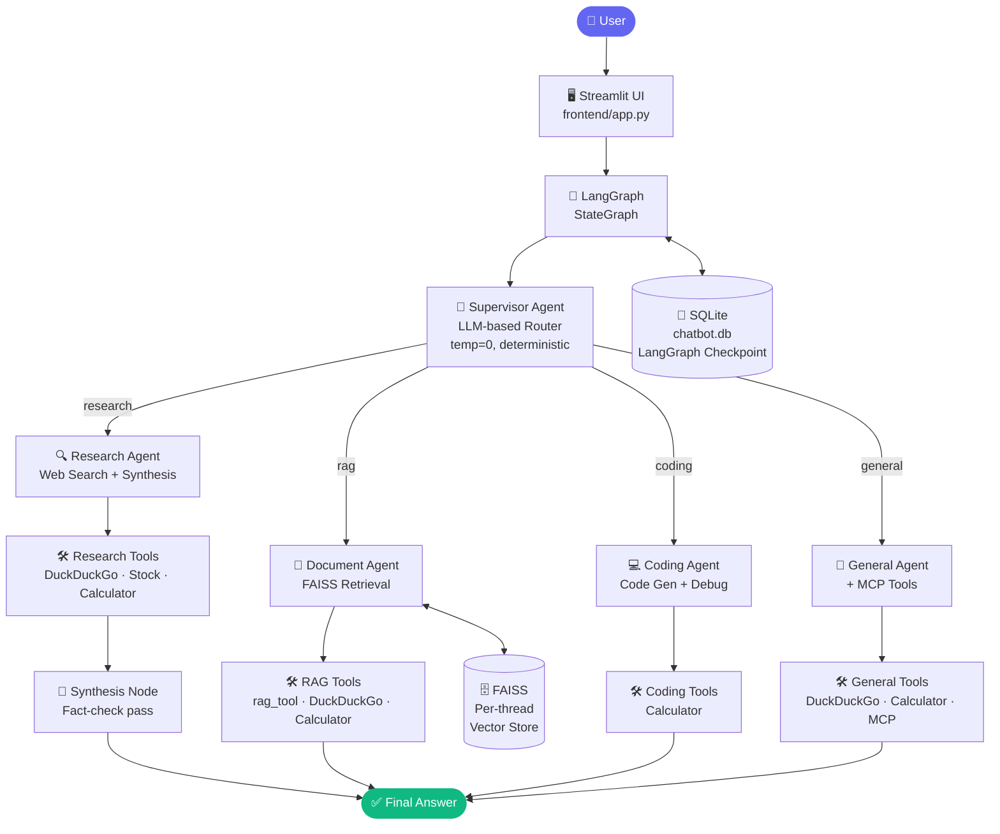
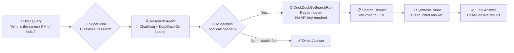
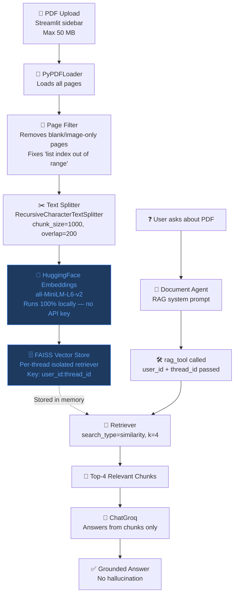
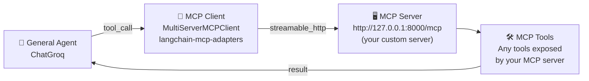

<div align="center">

# 🤖 Conversational AI Agent

### A production-grade, multi-agent AI Research Assistant

*Powered by LangGraph · ChatGroq · FAISS · DuckDuckGo · MCP · Streamlit*

---

[](https://python.org)
[](https://langchain.com)
[](https://langchain-ai.github.io/langgraph/)
[](https://groq.com)
[](https://streamlit.io)
[](https://github.com/facebookresearch/faiss)
[](https://modelcontextprotocol.io)
[](LICENSE)

</div>

---

## 📖 What Is This?

**Conversational AI Agent** is a fully-featured, multi-agent AI research assistant that combines the best of modern AI tooling into a single cohesive application.

Instead of a single LLM that guesses at everything, this system uses a **Supervisor → Specialist Agent** pattern: an intelligent router analyses each query and dispatches it to the most capable agent. The result is faster, more accurate, and more transparent responses.

> **Who is this for?**
> Developers learning LangGraph multi-agent patterns, researchers who need an AI assistant with live web search and document analysis, and anyone who wants a production-quality conversational AI they can run and extend locally.

---

## ✨ Features

| Feature | Description |
|:---|:---|
| 🧠 **Multi-Agent System** | Supervisor routes every query to the best specialist: Research, RAG, Coding, or General |
| 🌐 **Live Web Search** | DuckDuckGo search — no API key required, triggered automatically for current information |
| 📄 **PDF Document Q&A** | Upload any PDF; chunks are embedded with local HuggingFace models and stored in FAISS |
| 🔌 **MCP Integration** | Connects to an external MCP server via `streamable_http`; fails gracefully if unavailable |
| 📈 **Stock Price Lookup** | Real-time stock prices via Alpha Vantage API (optional key) |
| 🧮 **Calculator Tool** | Precise arithmetic — the LLM calls a real tool, not mental math |
| 💾 **Persistent Memory** | SQLite checkpointer stores every conversation permanently — restores history on reload |
| 💬 **Multi-Thread Conversations** | Unlimited independent chat threads, each with isolated history and document context |
| 🔒 **Multi-User Isolation** | Composite `user_id:thread_id` keys ensure no cross-user state contamination |
| ⚡ **Streaming Responses** | Token-level streaming via LangGraph `stream_mode="messages"` |
| 🏷️ **Agent Badges** | Every response shows which agent handled it (Research / Document / Coding / General) |
| 🎨 **Modern Dark UI** | ChatGPT-style interface with Inter font, gradients, glassmorphism, and micro-animations |

---

## 🏗️ System Architecture



---

## 🔄 How It Works — End-to-End Flow

```
1.  User types a message in the Streamlit chat interface
2.  Streamlit calls chatbot.stream(..., stream_mode="messages")
3.  LangGraph starts a new turn with the user's AgentState
4.  ─── Supervisor Node ───────────────────────────────────────────
      ChatGroq (temp=0) classifies the query into one of:
        • research  → current info / news / office holders
        • rag       → document / PDF questions
        • coding    → code generation, debugging, review
        • general   → conversation, timeless knowledge
5.  ─── Specialist Agent Node ───────────────────────────────────
      The routed agent invokes its LLM with a tailored system prompt
      and its bound tool set
6.  ─── Tool Execution (if needed) ──────────────────────────────
      If the LLM produces tool_calls, LangGraph routes to a ToolNode
      The tool executes and the result is appended to messages
7.  ─── Synthesis / Final Response ──────────────────────────────
      Research agent passes tool results through a synthesis node
      Other agents return the LLM response directly
8.  ─── Memory ──────────────────────────────────────────────────
      LangGraph SQLite checkpointer saves the full state
      The next message automatically loads the previous history
9.  Streamlit renders the streamed response token-by-token
    An agent badge is shown (Research / Document / Coding / General)
```

---

## 🌐 Web Search Workflow

The supervisor routes queries containing words like *current*, *latest*, *today*, *2024*, *2025*, *2026*, or any political/leadership questions directly to the **Research Agent**.



**When search is triggered automatically:**
- Current political leaders, ministers, officials
- Latest news and recent events
- Current stock/crypto/fuel prices
- Recent software releases, movies, products
- Any query with time-sensitive keywords

---

## 📄 PDF RAG Pipeline



**Thread isolation:** Every `(user_id, thread_id)` pair gets its own FAISS retriever. Uploading a PDF in Thread A never appears in Thread B. Multiple users on the same server are fully isolated.

**No PDF uploaded?** The Document Agent detects the missing retriever and politely asks the user to upload one — it does not hallucinate.

---

## 🔌 MCP Architecture

[Model Context Protocol (MCP)](https://modelcontextprotocol.io) is an open standard for connecting AI models to external tool servers. This project uses `langchain-mcp-adapters` to connect to a local MCP server.



**Graceful failure:** If the MCP server is unreachable at startup, the app logs a warning and continues normally with all other tools available. MCP tools are loaded once and cached.

**Configuration:**
```env
MCP_SERVER_URL=http://127.0.0.1:8000/mcp   # Your MCP server URL
MCP_ENABLED=true                             # Set false to skip entirely
```

---

## 🧩 Tools Reference

| Tool | Agent(s) | API Key? | Description |
|:---|:---:|:---:|:---|
| 🌐 `duckduckgo_search` | Research, General, Document | ❌ Free | Web search via DuckDuckGoSearchRun |
| 📈 `get_stock_price` | Research | ✅ Optional | Real-time stock quotes via Alpha Vantage |
| 🧮 `calculator` | All | ❌ None | Arithmetic operations (add/sub/mul/div) |
| 📄 `rag_tool` | Document | ❌ None | Semantic search over uploaded PDFs (FAISS) |
| 🔌 MCP tools | General | Depends | Dynamically loaded from your MCP server |

---

## 💾 Conversation Memory

```
SQLite Database: chatbot.db
        │
        ├── Thread: user_abc123:uuid-thread-1   ← User A, Chat 1
        ├── Thread: user_abc123:uuid-thread-2   ← User A, Chat 2
        ├── Thread: user_xyz789:uuid-thread-1   ← User B, Chat 1  
        └── Thread: user_xyz789:uuid-thread-2   ← User B, Chat 2
```

- **Composite key** `{user_id}:{thread_id}` is used as the LangGraph `thread_id`
- **User A** can never read or contaminate **User B's** threads
- Conversations survive app restarts — history is restored automatically
- The sidebar shows all previous conversations as clickable buttons
- First message becomes the conversation title automatically

**Powered by:** `langgraph-checkpoint-sqlite` → `SqliteSaver`

> **PostgreSQL migration:** Replace `SqliteSaver` with `AsyncPostgresSaver` from `langgraph-checkpoint-postgres`. The rest of the code is identical.

---

## 📁 Project Structure

```text
multi-agent-AI-research-assistant/
│
├── frontend/
│   └── app.py                    ← 🚀 Main entry point (run this)
│
├── core/                         ← Shared infrastructure
│   ├── config.py                 ← Centralised Settings dataclass + env vars
│   ├── state.py                  ← AgentState TypedDict (shared graph state)
│   ├── context.py                ← Chat-history windowing helpers
│   ├── memory.py                 ← SQLite checkpointer + user isolation
│   └── graph.py                  ← Multi-agent LangGraph assembly
│
├── agents/                       ← Specialist agent nodes
│   ├── supervisor.py             ← LLM-based query router (4 categories)
│   ├── general_agent.py          ← Conversation + MCP tools
│   ├── research_agent.py         ← Web search + synthesis pass
│   ├── rag_agent.py              ← PDF retrieval + FAISS
│   └── coding_agent.py           ← Code generation, debug, review
│
├── tools/                        ← Tool definitions
│   ├── tools.py                  ← calculator · stock · web search · rag_tool · PDF ingestion
│   └── mcp_tools.py              ← MCP loader (graceful failure)
│
├── run.py                        ← Optional launcher: `python run.py`
├── Dockerfile                    ← Container build
├── docker-compose.yml            ← Local container orchestration
├── requirements.txt              ← All Python dependencies
├── .env.example                  ← Environment variable template
├── .streamlit/config.toml        ← Streamlit server config
└── LICENSE
```

> **Note:** Earlier single-file prototypes (`streamlit_frontend*.py`, `langgraph_*_backend.py`) that this project evolved from have been removed — every feature they demonstrated (streaming, threading, SQLite persistence, MCP, PDF RAG) is fully implemented, with user isolation and multi-agent routing on top, in `frontend/app.py` + `core/`/`agents/`/`tools/` above.

---

## ⚙️ Environment Variables

| Variable | Required | Default | Description |
|:---|:---:|:---:|:---|
| `GROQ_API_KEY` | **Yes** | — | Groq API key for all LLM calls |
| `GROQ_MODEL` | No | `openai/gpt-oss-20b` | Groq model name |
| `ALPHAVANTAGE_API_KEY` | No | — | Stock price lookups (free tier available) |
| `MCP_SERVER_URL` | No | `http://127.0.0.1:8000/mcp` | MCP server endpoint |
| `MCP_ENABLED` | No | `true` | Set `false` to skip MCP entirely |
| `DB_PATH` | No | `chatbot.db` | SQLite database file path |
| `LANGSMITH_API_KEY` | No | — | LangSmith observability |
| `LANGSMITH_PROJECT` | No | `Multi-Agent-AI-Chatbot` | LangSmith project name |
| `LANGSMITH_TRACING` | No | `false` | Enable LangSmith tracing |
| `LOG_LEVEL` | No | `INFO` | Python logging level |
| `MAX_PDF_SIZE_MB` | No | `50` | Maximum PDF upload size |

---

## 🚀 Quick Start

### Prerequisites
- Python **3.10+**
- A [Groq API key](https://console.groq.com) (free tier available)
- Internet connection (for Groq API + first HuggingFace model download)

### 1 — Clone & create virtual environment

```bash
git clone https://github.com/rahulbicky/Conversational-AI-Agent.git
cd Conversational-AI-Agent

# Windows
python -m venv .venv
.\.venv\Scripts\Activate.ps1

# macOS / Linux
python3 -m venv .venv
source .venv/bin/activate
```

### 2 — Install dependencies

```bash
pip install --upgrade pip
pip install -r requirements.txt
```

> **Note:** The HuggingFace embedding model (`all-MiniLM-L6-v2`, ~90 MB) downloads automatically on first run and is cached locally. No HuggingFace API key required.

### 3 — Configure environment

```bash
# Windows
Copy-Item .env.example .env

# macOS / Linux
cp .env.example .env
```

Edit `.env` and add your Groq key:

```env
GROQ_API_KEY=gsk_your_key_here
```

### 4 — Run the application

```bash
streamlit run frontend/app.py
# or, equivalently
python run.py
```

Open **`http://localhost:8501`** in your browser. 🎉

---

## 🐳 Docker Deployment

```bash
# Build and run
docker compose up -d

# View logs
docker compose logs -f chatbot

# Stop
docker compose down
```

The container exposes port `8501`. HuggingFace model cache and SQLite database are persisted in named Docker volumes.

---

## 🧪 Testing the Application

| Test | What to do | Expected |
|:---|:---|:---|
| **General chat** | Type `"What is machine learning?"` | Direct answer, `💬 General` badge |
| **Current info** | Type `"Who is the current Prime Minister of India?"` | Web search triggered, `🔍 Research` badge |
| **PDF upload** | Upload a PDF from the sidebar | Shows pages + chunks; no error |
| **PDF Q&A** | Ask `"What is this PDF about?"` | Retrieves content, `📄 Document` badge |
| **No PDF** | New thread → ask about a PDF | Politely asks to upload one |
| **Coding** | Type `"Write a Python quicksort"` | Code block response, `💻 Coding` badge |
| **Calculator** | Type `"What is 2545 × 3?"` | Calculator tool called, exact result |
| **Multi-thread** | Open two tabs, upload different PDFs | Each thread has isolated context |
| **Persistence** | Restart the app | Previous conversations load from SQLite |

---

## 🧰 Tech Stack

| Layer | Technology | Version |
|:---|:---|:---:|
| **LLM** | ChatGroq (`openai/gpt-oss-20b`) | via `langchain-groq 0.3.6` |
| **Orchestration** | LangGraph StateGraph | `0.6.1` |
| **LLM Framework** | LangChain | `0.3.27` |
| **Embeddings** | HuggingFace `all-MiniLM-L6-v2` | local, no API key |
| **Vector Store** | FAISS (CPU) | `faiss-cpu` |
| **PDF Parsing** | PyPDFLoader (pypdf) | `pypdf` |
| **Web Search** | DuckDuckGoSearchRun | `duckduckgo-search` |
| **Stock Data** | Alpha Vantage REST API | `requests` |
| **MCP Client** | langchain-mcp-adapters | `0.1.14` |
| **Memory** | LangGraph SQLite Checkpointer | `langgraph-checkpoint-sqlite` |
| **Frontend** | Streamlit | `1.47.1` |
| **Config** | python-dotenv | `1.1.1` |
| **Observability** | LangSmith (optional) | via `langchain-core` |

---

## 🔒 Security Notes

- **Never commit `.env`** — it is in `.gitignore`
- **Never hardcode API keys** — all credentials are read from environment variables
- **Rotate any exposed key immediately** — treat a leaked key as compromised
- The SQLite database (`chatbot.db`) contains conversation history — do not commit it
- MCP server URL is configurable — never expose internal infrastructure URLs publicly

---

## 📜 License

[MIT License](LICENSE) — free to use, modify, and distribute.

---

<div align="center">

Built with ❤️ using **LangGraph** · **ChatGroq** · **FAISS** · **Streamlit**

*If this project helped you, consider giving it a ⭐ on GitHub!*

</div>
