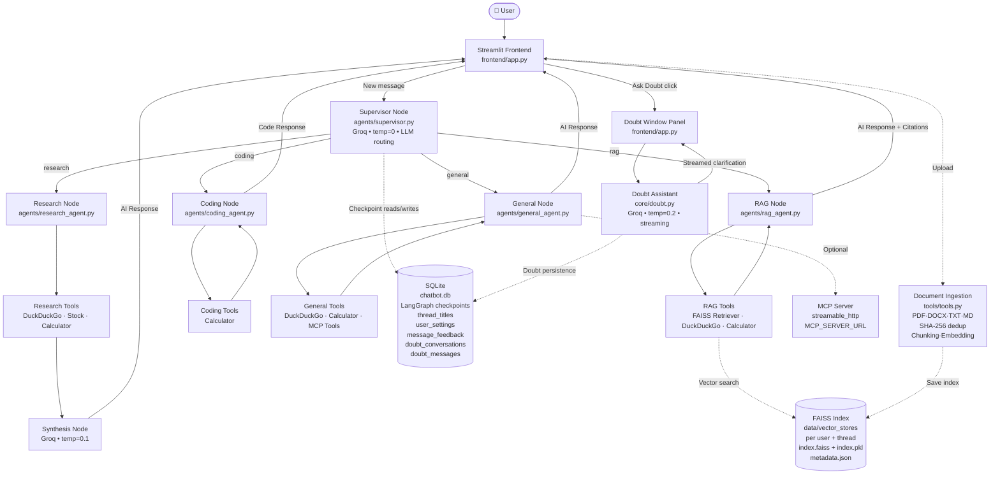

<div align="center">

# 🤖 AI Research Assistant

### An Intelligent Multi-Agent AI Research Assistant for Web Research, Document Intelligence, Coding Assistance, and Context-Aware Conversations.

*Built with LangGraph · Groq LPU · FAISS · DuckDuckGo · MCP · Streamlit*

---

[](https://python.org)
[](https://langchain.com)
[](https://langchain-ai.github.io/langgraph/)
[](https://groq.com)
[](https://streamlit.io)
[](https://github.com/facebookresearch/faiss)
[](https://sqlite.org)
[](https://docker.com)
[](LICENSE)

</div>

---

## 📋 Table of Contents

- [Project Overview](#-project-overview)
- [Key Features](#-key-features)
  - [Multi-Agent Architecture](#multi-agent-ai-architecture)
  - [Advanced RAG Pipeline](#advanced-rag-pipeline)
  - [Contextual Doubt Window](#-contextual-doubt-window)
  - [Chat Experience](#chat-experience)
  - [Conversation Management](#conversation-management)
  - [Other Capabilities](#other-capabilities)
- [Application Screenshots](#-application-screenshots)
- [System Architecture](#-system-architecture)
- [Tech Stack](#-tech-stack)
- [Project Structure](#-project-structure)
- [Installation & Setup](#-installation--setup)
- [Environment Variables](#-environment-variables)
- [Docker Deployment](#-docker-deployment)
- [Future Roadmap](#-future-roadmap)
- [Security Notes](#-security-notes)
- [License](#-license)

---

## 🧠 Project Overview

**AI Research Assistant** is a fully-featured multi-agent AI application that goes well beyond a standard chatbot. Rather than using a single LLM to handle every type of query, the system uses a **Supervisor → Specialist Agent** architecture built on [LangGraph](https://langchain-ai.github.io/langgraph/).

An intelligent supervisor agent classifies each incoming query and routes it to the most appropriate specialist — a **Web Research Agent** for real-time information, a **RAG Agent** for uploaded document analysis, a **Coding Agent** for programming tasks, or a **General Agent** for open-ended conversation. Every agent has access to relevant tools, and responses are grounded in retrieved evidence rather than raw model memory.

### Problems This Project Solves

| Problem | Solution |
|:---|:---|
| LLMs hallucinate on current events | Web Research Agent always searches before answering |
| Generic chatbots cannot answer questions about your documents | Multi-document RAG Agent with FAISS vector search |
| Conversations are lost on restart | Full SQLite checkpoint persistence via LangGraph |
| Follow-up questions derail main conversation flow | Contextual Doubt Window — isolated side-panel for clarifications |
| Single-model systems cannot specialise | Per-domain specialist agents with dedicated system prompts and tools |
| PDFs re-embedded on every upload | SHA-256 content hashing prevents duplicate ingestion |

---

## ✨ Key Features

### Multi-Agent AI Architecture

The core of this project is a **LangGraph StateGraph** with five nodes: one supervisor and four specialists.

```
User Query
    │
    ▼
Supervisor Node  ←── LLM-based classification (temperature=0)
    │
    ├── "research"  → Research Node → research_tools → Synthesis Node → END
    ├── "rag"       → RAG Node      → rag_tools      → RAG Node      → END
    ├── "coding"    → Coding Node   → coding_tools   → Coding Node   → END
    └── "general"   → General Node  → general_tools  → General Node  → END
```

**Supervisor Agent** (`agents/supervisor.py`)
- Uses Groq LLM at `temperature=0` for deterministic routing
- Classifies queries into: `general | research | rag | coding`
- Uses recent conversation context to handle follow-up questions correctly
- Falls back to `general` gracefully on any classification error
- Double-attempts parsing before defaulting — never crashes the application

**Research Agent** (`agents/research_agent.py`)
- Mandatory web search for current information: office holders, news, prices, sports
- DuckDuckGo search returns structured `{title, link, snippet}` for citable sources
- Optional Alpha Vantage stock price tool
- Dedicated **synthesis node** produces clean final answers from tool results, preventing hallucination loops
- Sources section with clickable links is always included

**RAG Agent** (`agents/rag_agent.py`)
- Retrieves semantically relevant passages from uploaded documents
- Cites source filename and page number (e.g. `[report.pdf, p. 4]`)
- Falls back to web search when documents lack a relevant answer
- Gracefully handles no-document state without errors

**Coding Agent** (`agents/coding_agent.py`)
- Code generation, debugging, review, and explanation
- All languages supported
- Uses calculator tool for arithmetic verification
- `temperature=0.1` for near-deterministic code output

**General Agent** (`agents/general_agent.py`)
- Casual conversation, timeless knowledge, greetings
- Has web search and calculator as optional fallback tools
- Dynamically injects MCP tools at startup if a server is reachable

---

### Advanced RAG Pipeline

Document intelligence is handled end-to-end in `tools/tools.py` with full isolation between users and conversation threads.

**Supported Formats:** PDF · DOCX · TXT · Markdown (`.md`)

**Ingestion Pipeline:**

1. **File validation** — extension check, 50 MB size limit
2. **SHA-256 duplicate detection** — same file content is never re-embedded
3. **Format-specific extraction:**
   - PDF: `PyPDFLoader` page-by-page, with per-page metadata
   - DOCX: `python-docx` or stdlib `zipfile + ElementTree` fallback
   - TXT: multi-encoding detection (UTF-8, UTF-8-BOM, Latin-1, CP-1252)
   - Markdown: same multi-encoding path
4. **Chunking** — `RecursiveCharacterTextSplitter` with `chunk_size=1000`, `chunk_overlap=200`
5. **Embedding** — local `sentence-transformers/all-MiniLM-L6-v2` (no API key required)
6. **FAISS indexing** — new uploads are **appended** to the existing index; no full re-index
7. **Persistent disk storage** — FAISS index (`index.faiss`, `index.pkl`) + `metadata.json` written to `data/vector_stores/{user_id}/{thread_id}/`
8. **Retrieval** — `similarity` search, top-6 passages per query

**Multi-document support:** multiple files can be uploaded to the same conversation; chunks from all documents are merged into one FAISS index. The agent cites which document and page each fact came from.

---

### 🔍 Contextual Doubt Window

> **"Understand Any AI Response Without Interrupting Your Main Conversation"**

This is one of the most distinctive features of this project. It solves a common problem: you receive a detailed AI response, but one paragraph contains a term or concept you do not fully understand. If you ask a follow-up question in the main chat, it can derail the conversation or cause the AI to lose context from the original response.

#### How It Works

1. The user receives an AI-generated response in the main chat.
2. A small **orange `❓ Ask Doubt`** button appears at the bottom-right of every AI response.
3. The user clicks the icon. A separate **Doubt Chat Panel** opens on the right side of the screen.
4. The original user question and the full AI response are automatically injected as context for the Doubt Assistant.
5. The user asks any clarifying question — about a specific word, concept, code snippet, or step.
6. The **Contextual Doubt Assistant** (powered by Groq) responds with a focused explanation anchored to the original response.
7. The user can continue the doubt conversation with as many follow-up questions as needed.
8. When done, the doubt panel can be closed without affecting the main conversation.

#### Verified Technical Implementation

| Component | Implementation | File |
|:---|:---|:---|
| Doubt LLM | Dedicated `ChatGroq` instance, `temperature=0.2` | `core/doubt.py` |
| Streaming | `stream_doubt_answer()` yields tokens for real-time rendering | `core/doubt.py` |
| Context injection | `DOUBT_SYSTEM_TEMPLATE` injects `{original_prompt}` + `{original_response}` | `core/doubt.py` |
| Persistence | `doubt_conversations` table stores metadata; `doubt_messages` stores the full thread | `core/memory.py` |
| Composite key | `"{user_id}:{thread_id}:{message_index}"` — each AI message has an independent doubt thread | `core/memory.py` |
| Cascade delete | Deleting a main conversation also deletes all its doubt threads (transactional) | `core/memory.py` |
| Isolation | Doubt LLM calls are entirely separate from the LangGraph graph — no checkpoint side-effects | `core/doubt.py` |
| UI trigger | Floating orange button injected via `st.markdown` below each AI message | `frontend/app.py` |
| Panel layout | `st.columns([3, 2])` splits main chat and doubt panel dynamically | `frontend/app.py` |

**Database Schema:**

```sql
-- Metadata for each doubt conversation (one per AI response)
CREATE TABLE doubt_conversations (
    doubt_id            TEXT PRIMARY KEY,  -- "{user_id}:{thread_id}:{message_index}"
    user_id             TEXT NOT NULL,
    parent_thread_id    TEXT NOT NULL,
    message_index       INTEGER NOT NULL,
    original_prompt     TEXT,
    original_response   TEXT,
    created_at          TIMESTAMP DEFAULT CURRENT_TIMESTAMP
);

-- Messages in the doubt conversation
CREATE TABLE doubt_messages (
    id         INTEGER PRIMARY KEY AUTOINCREMENT,
    doubt_id   TEXT NOT NULL,
    role       TEXT NOT NULL,     -- 'user' | 'assistant'
    content    TEXT NOT NULL,
    created_at TIMESTAMP DEFAULT CURRENT_TIMESTAMP
);
```

The doubt system runs as a **completely isolated execution path** — it has no interaction with the main LangGraph checkpoint, does not modify `AgentState`, and cannot affect the main conversation's thread or history.

---

### Chat Experience

| Feature | Status | Details |
|:---|:---:|:---|
| **Copy AI Response** | ✅ | Clipboard copy button on every AI message |
| **Regenerate Response** | ✅ | Rewinds LangGraph checkpoint to last `HumanMessage`, re-streams |
| **Edit User Message** | ✅ | Inline ✏️ edit button; rewrites checkpoint from that point forward |
| **Stop Generation** | ✅ | Stop flag checked during streaming; avoids corrupted state |
| **Conversation Search** | ✅ | Searches thread titles + checkpoint message content in SQLite |
| **Markdown Rendering** | ✅ | Full GFM: headers, tables, code blocks, blockquotes, bold, italic |
| **Code Highlighting** | ✅ | Streamlit's native code renderer with language-specific blocks |
| **Conversation Export** | ✅ | Download as Markdown or plain text (`core/export.py`) |
| **Dark / Light Theme** | ✅ | Toggle persisted in SQLite `user_settings`; orange palette in both |
| **Thinking Indicator** | ✅ | Animated 3-dot pulse while agent is processing |
| **Agent Badge** | ✅ | Coloured pill shows which agent answered each message |
| **Message Feedback** | ✅ | 👍 / 👎 buttons on AI responses, stored per-message in SQLite |
| **Duplicate Prevention** | ✅ | Idempotency guard prevents consecutive identical messages |
| **Disabled Input** | ✅ | Chat input disabled during generation to prevent double-submit |

---

### Conversation Management

- **Unlimited conversations** — each stored as an isolated LangGraph thread in SQLite
- **Persistent history** — full conversation restored from checkpoints on page reload
- **Auto-title generation** — first message is used to name the thread automatically
- **Rename conversations** — inline rename with validation (max 120 chars)
- **Delete conversations** — transactional deletion: checkpoints + titles + feedback + doubt threads
- **Per-user isolation** — composite key `{user_id}:{thread_id}` prevents cross-user data access
- **New Chat** — creates a fresh UUID thread; previous threads remain accessible in the sidebar

---

### Other Capabilities

**MCP Tool Integration** (`tools/mcp_tools.py`)
- Connects to any MCP-compatible server via `streamable_http` transport
- Tools are dynamically injected into the General Agent at startup
- Graceful degradation: application starts normally if the MCP server is unreachable
- MCP can be disabled entirely with `MCP_ENABLED=false`

**Stock Price Tool** (`tools/tools.py`)
- Real-time stock quotes via Alpha Vantage REST API
- Requires `ALPHAVANTAGE_API_KEY` (free tier available)
- Returns structured JSON; LLM formats the result for the user

**Calculator Tool** (`tools/tools.py`)
- Precise arithmetic (add, sub, mul, div) via tool call — not LLM mental math
- Used by Research, RAG, Coding, and General agents

**Docker Support**
- Multi-stage `Dockerfile` based on `python:3.11-slim`
- `docker-compose.yml` with named volumes for SQLite database and HuggingFace model cache
- Health check endpoint at `/_stcore/health`

**LangSmith Observability** (optional)
- Full trace logging when `LANGSMITH_TRACING=true`
- Configurable project name via `LANGSMITH_PROJECT`

---

## 📸 Application Screenshots

> **Note on screenshots:** The application is running and fully functional at `http://localhost:8501`. Real screenshots need to be captured manually and placed in `docs/screenshots/`. Placeholder filenames are listed below so the structure is ready.

### Screenshots Needed — Please Capture These

To complete the visual documentation, open the application at `http://localhost:8501` and capture the following screenshots. Save them to `docs/screenshots/` with the exact filenames listed:

| # | Screenshot | Filename | Instructions |
|:--:|:---|:---|:---|
| 1 | **Welcome / Dashboard** | `01_welcome_screen.png` | Open a new chat; capture the hero header + 4 capability cards |
| 2 | **Main Chat — AI Response** | `02_chat_response.png` | Ask a question (e.g. "What is LangGraph?"); capture the exchange with agent badge |
| 3 | **Contextual Doubt Window** | `03_doubt_window.png` | Click "Ask Doubt" on an AI response; capture the split panel |
| 4 | **Document Upload** | `04_document_upload.png` | Sidebar with a document uploaded and shown in the list |
| 5 | **Document Q&A with Citations** | `05_rag_citations.png` | Ask a question about an uploaded PDF; capture the response with source citations |
| 6 | **Web Research Response** | `06_web_research.png` | Ask a current-events question; capture the Research badge + Sources section |
| 7 | **Conversation Sidebar** | `07_conversation_list.png` | Several named conversations in the sidebar with rename/delete icons |
| 8 | **Light Theme** | `08_light_theme.png` | Switch to Light theme; capture the full interface |
| 9 | **Coding Assistant** | `09_coding_response.png` | Ask for code (e.g. "Write a Python binary search"); capture formatted code block |

Once you place these in `docs/screenshots/`, update this section with:

```markdown

*Welcome screen with capability cards*
```

---

## 🏗 System Architecture



### Execution Paths

| Path | Description |
|:---|:---|
| **Main conversation** | User → Streamlit → LangGraph graph → Specialist Agent → Tools (optional) → Response |
| **Doubt conversation** | User → Doubt panel → `core/doubt.py` → Groq (direct, no graph) → Streamed answer |
| **Document upload** | User → `ingest_document()` → Chunk → Embed → Append to FAISS → Persist to disk |
| **Checkpoint restore** | Streamlit reload → `chatbot.get_state()` → Deduplicated message list → Session state |

---

## 🛠 Tech Stack

| Technology | Purpose | Usage in This Project |
|:---|:---|:---|
| **Python 3.10+** | Runtime | Entire application |
| **Streamlit 1.47.1** | Frontend | Full UI: chat, sidebar, file upload, theme, layout |
| **LangGraph 0.6.1** | Agent orchestration | StateGraph, nodes, conditional edges, checkpointing |
| **LangChain 0.3.27** | LLM framework | Message types, tool definitions, document loaders |
| **ChatGroq (langchain-groq 0.3.6)** | LLM provider | All LLM calls: supervisor, agents, doubt assistant |
| **FAISS (faiss-cpu)** | Vector search | Per-thread document index; similarity search top-6 |
| **sentence-transformers** | Embeddings | `all-MiniLM-L6-v2` local model; no API key |
| **langgraph-checkpoint-sqlite** | Conversation persistence | Checkpoint storage, message history, thread isolation |
| **SQLite (stdlib sqlite3)** | Auxiliary tables | Thread titles, user settings, feedback, doubt data |
| **DuckDuckGo (ddgs)** | Web search | Free, no-key web search returning structured results |
| **pypdf / PyPDFLoader** | PDF parsing | Page-by-page extraction with metadata |
| **python-docx / stdlib zipfile** | DOCX parsing | Fallback-aware Word document extraction |
| **langchain-mcp-adapters 0.1.14** | MCP integration | Dynamic tool loading from MCP server |
| **requests** | HTTP client | Alpha Vantage stock API calls |
| **python-dotenv 1.1.1** | Configuration | `.env` file loading |
| **Docker / docker-compose** | Containerisation | Build, run, persist volumes for DB + HF cache |
| **LangSmith** (optional) | Observability | Full trace logging per LLM call |

---

## 📁 Project Structure

```
multi-agent-AI-research-assistant/
│
├── frontend/
│   └── app.py                  # Main Streamlit application (UI, session, rendering)
│
├── agents/
│   ├── supervisor.py           # LLM-based query router → general|research|rag|coding
│   ├── research_agent.py       # Web research + synthesis pipeline
│   ├── rag_agent.py            # Document Q&A with FAISS retrieval + citations
│   ├── coding_agent.py         # Code generation, debugging, review
│   ├── general_agent.py        # General conversation + MCP tool injection
│   └── __init__.py
│
├── core/
│   ├── config.py               # Settings dataclass; all env vars read here
│   ├── graph.py                # LangGraph StateGraph assembly and compilation
│   ├── state.py                # AgentState TypedDict (messages, next_agent, user_id…)
│   ├── memory.py               # SQLite checkpointer, thread management, doubt tables
│   ├── doubt.py                # Contextual Doubt Assistant (LLM + streaming + DB)
│   ├── export.py               # Conversation export to Markdown and plain text
│   ├── context.py              # Conversation history trimming utilities
│   └── __init__.py
│
├── tools/
│   ├── tools.py                # All tool definitions: search, calculator, stock, RAG
│   │                           # + document ingestion (PDF, DOCX, TXT, MD)
│   │                           # + FAISS vector store management
│   ├── mcp_tools.py            # MCP server client and tool loader
│   └── __init__.py
│
├── data/
│   └── vector_stores/          # Persistent FAISS indexes (gitignored)
│       └── {user_id}/
│           └── {thread_id}/
│               ├── index.faiss
│               ├── index.pkl
│               └── metadata.json
│
├── docs/
│   └── screenshots/            # Application screenshots (see §Screenshots)
│
├── .streamlit/
│   └── config.toml             # Streamlit theme, server config, file watcher
│
├── .env.example                # Environment variable template (commit this)
├── .env                        # Your local secrets (never commit — gitignored)
├── .gitignore                  # Excludes .env, chatbot.db, .venv, data/, scratch/
├── requirements.txt            # Pinned Python dependencies
├── Dockerfile                  # python:3.11-slim image
├── docker-compose.yml          # Service definition with volume mounts
├── run.py                      # Convenience launcher (streamlit run frontend/app.py)
├── LICENSE                     # MIT License
└── README.md                   # This file
```

**Key design decisions:**

- `core/` owns all business logic and data access; `agents/` and `tools/` import from it
- `tools/tools.py` is the single source of truth for all tool definitions — no duplicate `@tool` declarations
- `core/memory.py` owns all SQLite schema: LangGraph checkpoints + thread titles + settings + feedback + doubt tables
- `core/doubt.py` is completely independent of the LangGraph graph — zero side effects on main conversation state

---

## 🚀 Installation & Setup

### Prerequisites

- **Python 3.10 or later**
- **pip** (bundled with Python)
- A **[Groq API key](https://console.groq.com)** — free tier available, no credit card required
- Internet connection for the first run (downloads `all-MiniLM-L6-v2` embedding model, ~90 MB, cached locally)

---

### Step 1 — Clone the repository

```bash
git clone https://github.com/rahulbicky/multi-agent-AI-research-assistant.git
cd multi-agent-AI-research-assistant
```

---

### Step 2 — Create and activate a virtual environment

**Windows (PowerShell):**
```powershell
python -m venv .venv
.\.venv\Scripts\Activate.ps1
```

**macOS / Linux:**
```bash
python3 -m venv .venv
source .venv/bin/activate
```

---

### Step 3 — Install dependencies

```bash
pip install --upgrade pip
pip install -r requirements.txt
```

> **Note:** The HuggingFace embedding model (`all-MiniLM-L6-v2`) is downloaded automatically on first run. This takes 1–2 minutes and requires ~90 MB of disk space. It is cached in `~/.cache/huggingface/` and does not re-download on subsequent runs.

---

### Step 4 — Configure environment variables

**Windows:**
```powershell
Copy-Item .env.example .env
```

**macOS / Linux:**
```bash
cp .env.example .env
```

Open `.env` and set your Groq API key:

```env
GROQ_API_KEY=gsk_your_actual_key_here
```

All other variables are optional — see [Environment Variables](#-environment-variables) for the full list.

---

### Step 5 — Run the application

```bash
streamlit run frontend/app.py
```

Or use the convenience launcher:
```bash
python run.py
```

Open **`http://localhost:8501`** in your browser. 🎉

---

## 🔐 Environment Variables

Copy `.env.example` to `.env` and configure as needed. Never commit `.env` to version control.

| Variable | Required | Default | Description |
|:---|:---:|:---|:---|
| `GROQ_API_KEY` | **Yes** | — | Groq API key. Get one free at [console.groq.com](https://console.groq.com) |
| `GROQ_MODEL` | No | `openai/gpt-oss-20b` | Groq model name |
| `GROQ_TEMPERATURE` | No | `0` | Default LLM temperature (overridden per-agent) |
| `EMBEDDING_MODEL` | No | `sentence-transformers/all-MiniLM-L6-v2` | Local HuggingFace embedding model |
| `DB_PATH` | No | `chatbot.db` | SQLite database file path |
| `VECTOR_STORE_DIR` | No | `data/vector_stores` | Directory for FAISS indexes |
| `ALPHAVANTAGE_API_KEY` | No | — | Stock price lookup. Free tier at [alphavantage.co](https://alphavantage.co) |
| `MCP_SERVER_URL` | No | `http://127.0.0.1:8000/mcp` | MCP tool server URL |
| `MCP_ENABLED` | No | `true` | Set `false` to skip MCP entirely |
| `LANGSMITH_API_KEY` | No | — | LangSmith observability. Free at [smith.langchain.com](https://smith.langchain.com) |
| `LANGSMITH_PROJECT` | No | `Multi-Agent-AI-Chatbot` | LangSmith project name |
| `LANGSMITH_TRACING` | No | `false` | Enable LangSmith trace logging |
| `HF_TOKEN` | No | — | HuggingFace token (only for private models or higher rate limits) |
| `LOG_LEVEL` | No | `INFO` | Python logging level (`DEBUG`, `INFO`, `WARNING`, `ERROR`) |
| `MAX_PDF_SIZE_MB` | No | `50` | Maximum file size for document uploads |

**Security checklist:**
- `.env` is listed in `.gitignore` — never committed
- `chatbot.db` (conversation history) is in `.gitignore`
- `data/` (FAISS indexes) is in `.gitignore`
- `scratch/` (test scripts) is in `.gitignore`
- `.streamlit/secrets.toml` is in `.gitignore`

---

## 🐳 Docker Deployment

```bash
# Build the image and start the container
docker compose up -d

# View real-time logs
docker compose logs -f chatbot

# Stop and remove the container (volumes are preserved)
docker compose down
```

The container:
- Exposes port `8501`
- Persists the SQLite database in a named Docker volume (`chatbot_data`)
- Persists the HuggingFace model cache in a named Docker volume (`hf_cache`)
- Runs a health check every 30 seconds against `/_stcore/health`
- Restarts automatically unless explicitly stopped (`restart: unless-stopped`)

Pass your API key via environment:
```bash
GROQ_API_KEY=gsk_your_key docker compose up -d
```

---

## 🔭 Future Roadmap

### ✅ Completed
- [x] LangGraph multi-agent supervisor architecture
- [x] Web research with DuckDuckGo (structured results + citations)
- [x] Multi-format document ingestion (PDF, DOCX, TXT, Markdown)
- [x] Persistent FAISS vector storage per user and thread
- [x] SHA-256 duplicate document detection
- [x] SQLite conversation persistence with LangGraph checkpointer
- [x] Rename, delete, and search conversations
- [x] Copy response, regenerate, edit message, stop generation
- [x] Contextual Doubt Window (isolated side-panel + dedicated database)
- [x] Dark and Light theme with orange/coral palette
- [x] Conversation export to Markdown and plain text
- [x] Message feedback (thumbs up / down)
- [x] MCP tool server integration with graceful fallback
- [x] Docker containerisation with volume persistence
- [x] LangSmith observability integration

### 🔄 In Progress / Partial
- [ ] Demo GIF showing the full Contextual Doubt Window workflow

### 📋 Planned
- [ ] **Select-to-Ask** — select a word or phrase in an AI response to open a doubt query pre-filled with the selection
- [ ] **Hybrid retrieval** — combine BM25 keyword search with FAISS semantic search for improved recall
- [ ] **Reranking** — cross-encoder reranker to improve passage relevance before generation
- [ ] **Long-term memory** — summarisation-based memory for conversations exceeding context windows
- [ ] **User authentication** — login system for persistent multi-user deployments
- [ ] **PostgreSQL migration** — replace SQLite with PostgreSQL for production scale (migration path documented in `core/memory.py`)
- [ ] **Advanced evaluation** — LangSmith dataset-based evaluation for RAG quality metrics
- [ ] **Voice input** — speech-to-text query entry

---

## 🔒 Security Notes

- **Never commit `.env`** — it is explicitly listed in `.gitignore`
- **Never hardcode API keys** — all credentials are read exclusively from environment variables via `core/config.py`
- **Rotate any exposed key immediately** — treat a leaked `GROQ_API_KEY` as fully compromised
- **SQLite database** (`chatbot.db`) contains conversation history — do not commit it; it is in `.gitignore`
- **FAISS indexes** (`data/`) contain document embeddings — do not commit them
- **Path traversal protection** — `get_vector_store_path()` explicitly rejects `..`, `/`, and `\` in user/thread IDs
- **MCP server URL** — keep internal infrastructure URLs private; do not expose in public configuration

---

## 📜 License

[MIT License](LICENSE) — Copyright © 2026 Rahul Kumar

Free to use, modify, and distribute with attribution.

---

<div align="center">

Built with ❤️ using **LangGraph** · **Groq** · **FAISS** · **Streamlit**

*If this project helped you, consider giving it a ⭐ on GitHub!*

**Repository:** [github.com/rahulbicky/multi-agent-AI-research-assistant](https://github.com/rahulbicky/multi-agent-AI-research-assistant)

</div>
